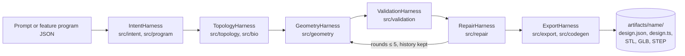
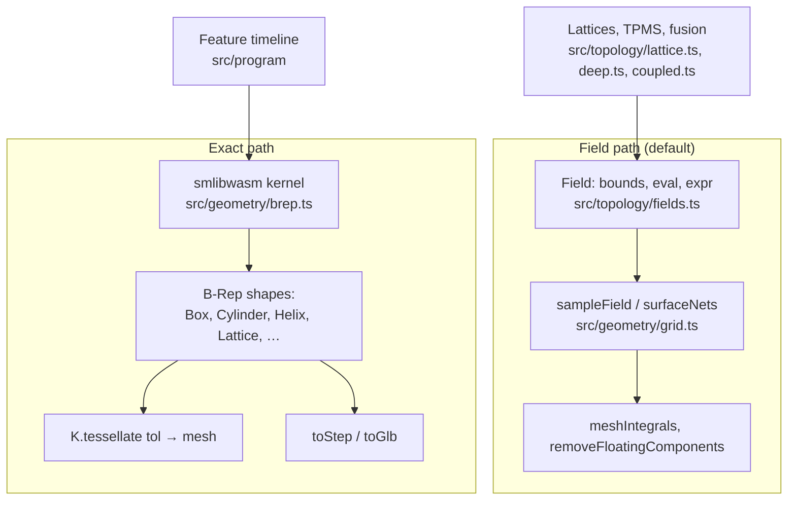
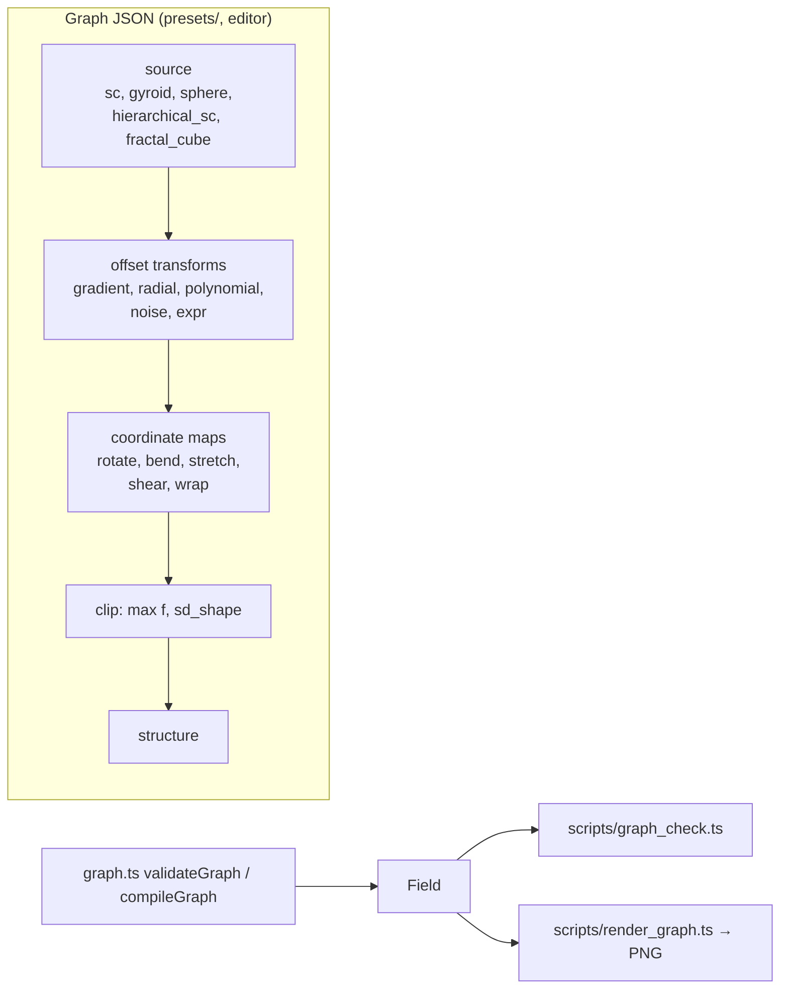
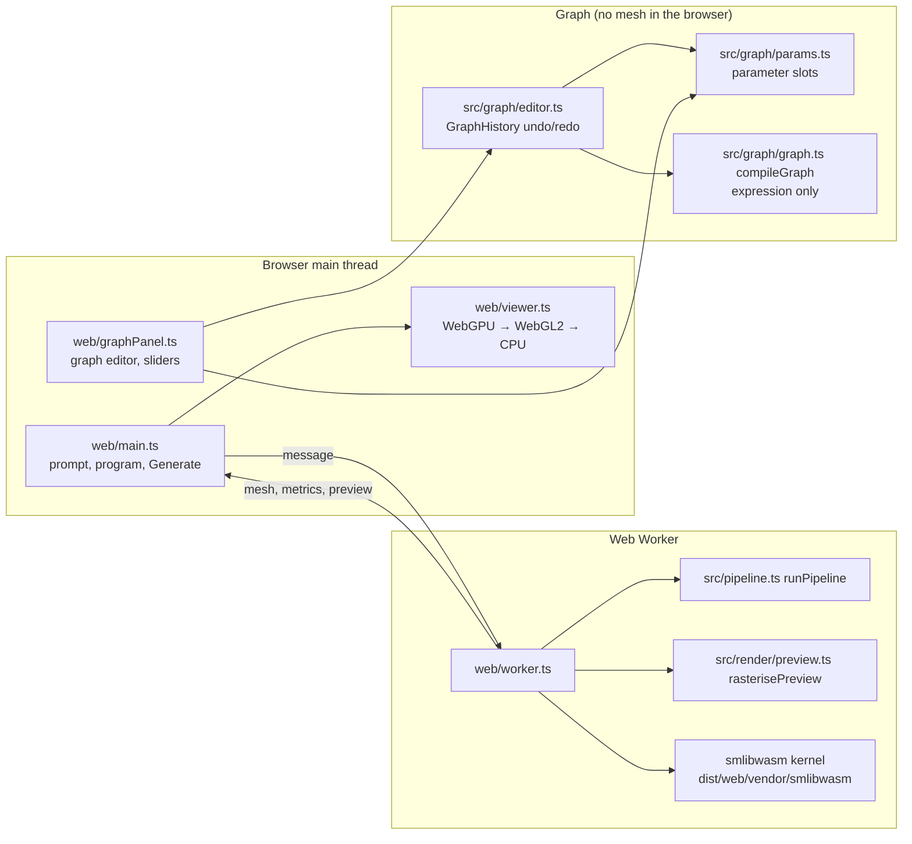
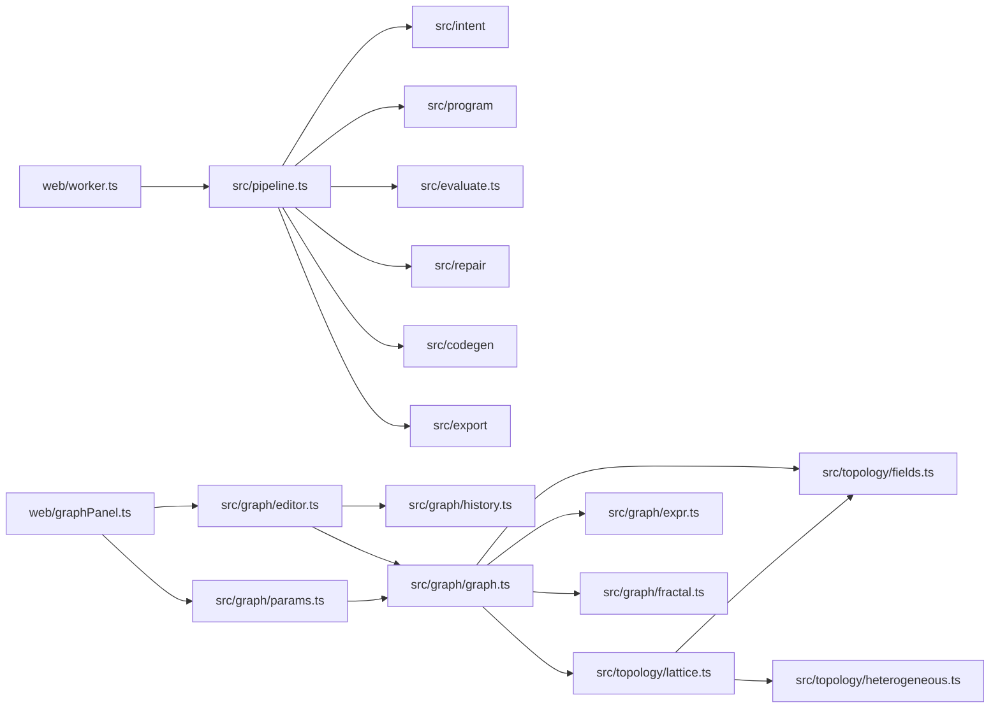

# Architecture

Diagrams use Mermaid (renders on GitHub). Module names match `src/` and `web/` at this commit.

## 1. Pipeline (prompt or program → design, checks, export)

Every harness returns `observations`, `limitations`, `unknowns` and `evidence`. `src/pipeline.ts`
(`runPipeline`) and `src/api.ts` (`runDesign`) run the chain for the CLI and the web worker.

## 2. Geometry: field path and exact path

## 3. Structure graph

Notes:
- Offset transforms are `f − g(x)`. Maps use inverse maps and σ_max (or a constant Λ for `wrap`) for the
  Lipschitz bound. `clip` is an intersection, so it leaves open edges and no closed skin.
- `expr` text is parsed by `src/graph/expr.ts` (a recursive-descent parser, no `eval`).
- `fractal_cube` (`src/graph/fractal.ts`) is a skeleton field with a bucket grid.

## 4. Web app

The graph panel edits and compiles graphs, and shows the expression. Meshing a graph happens in the
command-line scripts (`scripts/render_graph.ts`), not in the browser.

## 5. Module dependencies (checked imports)

The pipeline does not import `src/graph/`. The two paths meet only at `Field` (`src/topology/fields.ts`).

## 6. Build outputs and ignored files

- `dist/web/`: built web app (ignored by git).
- `artifacts/`: CLI outputs (ignored by git).
- `examples/`: committed renders and records (with READMEs). Large STEP and mesh.bin files are not tracked.
