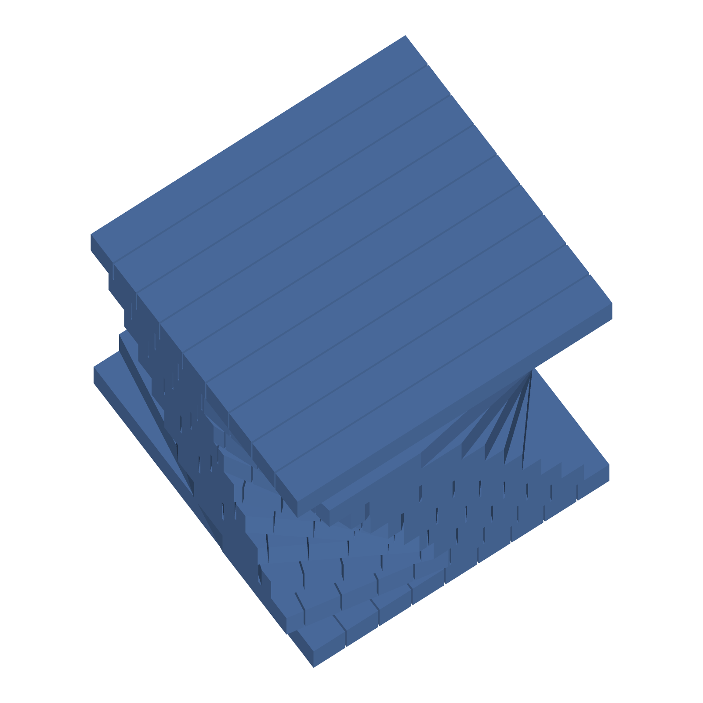
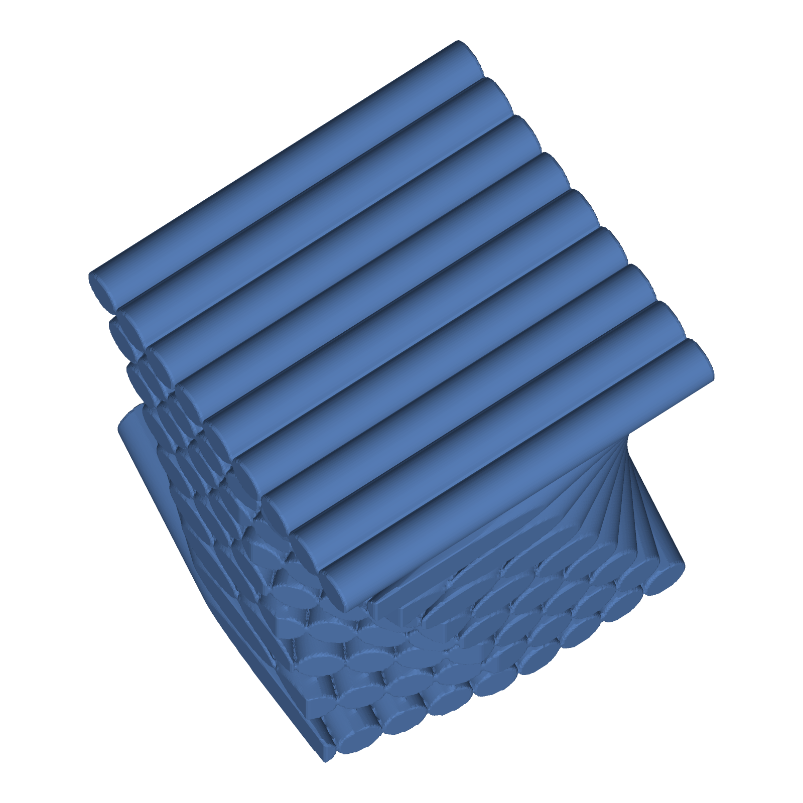
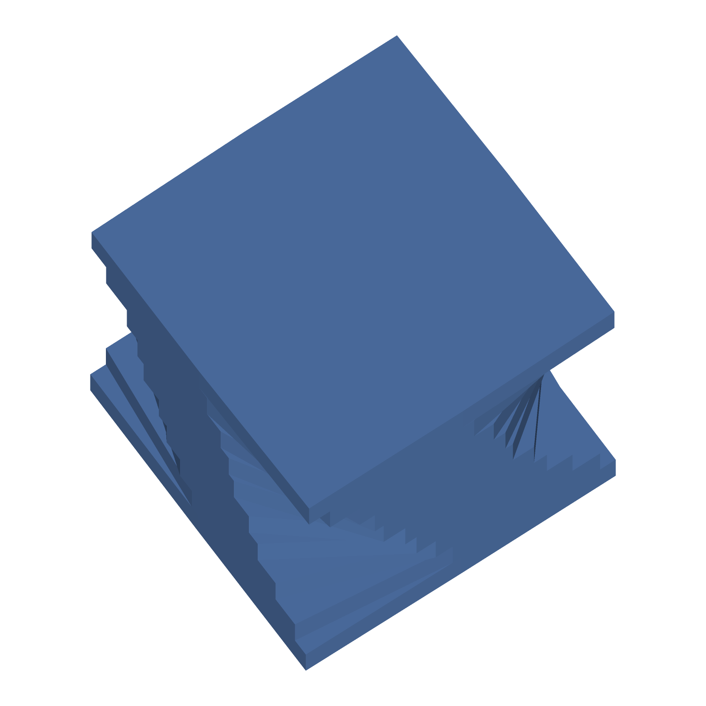
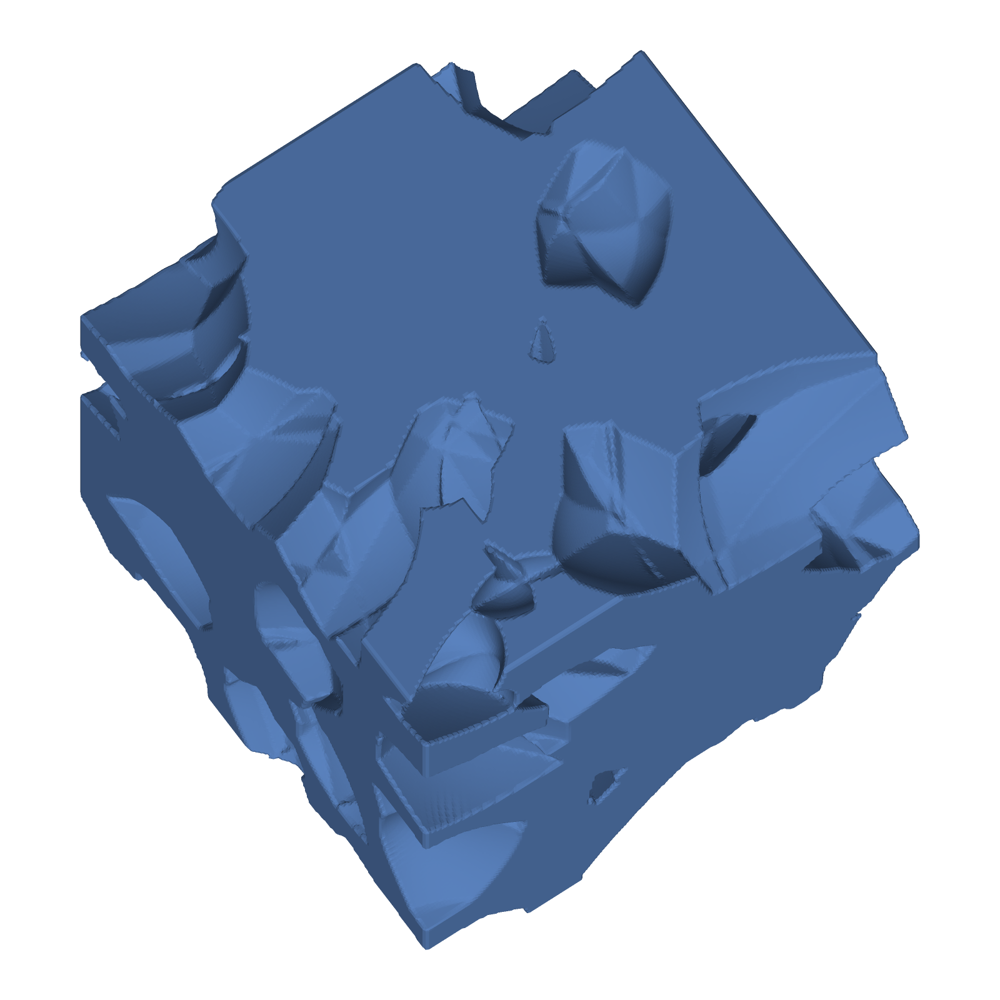
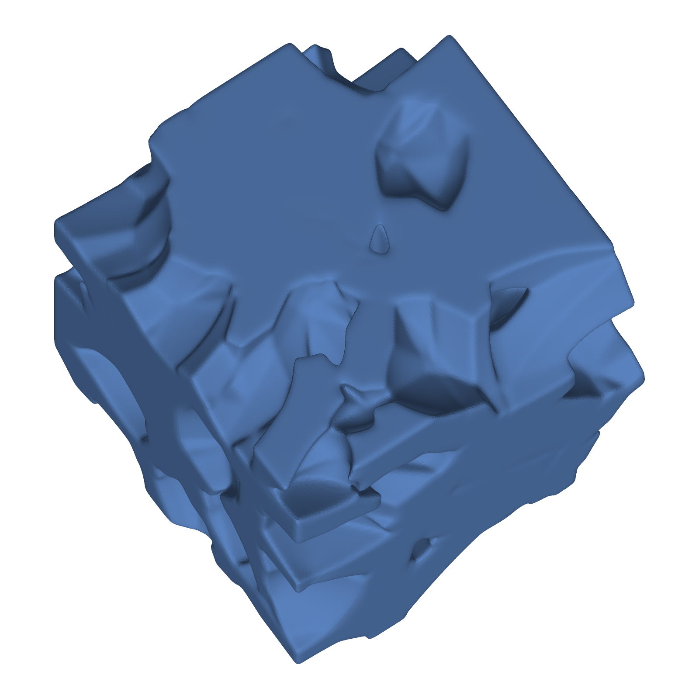
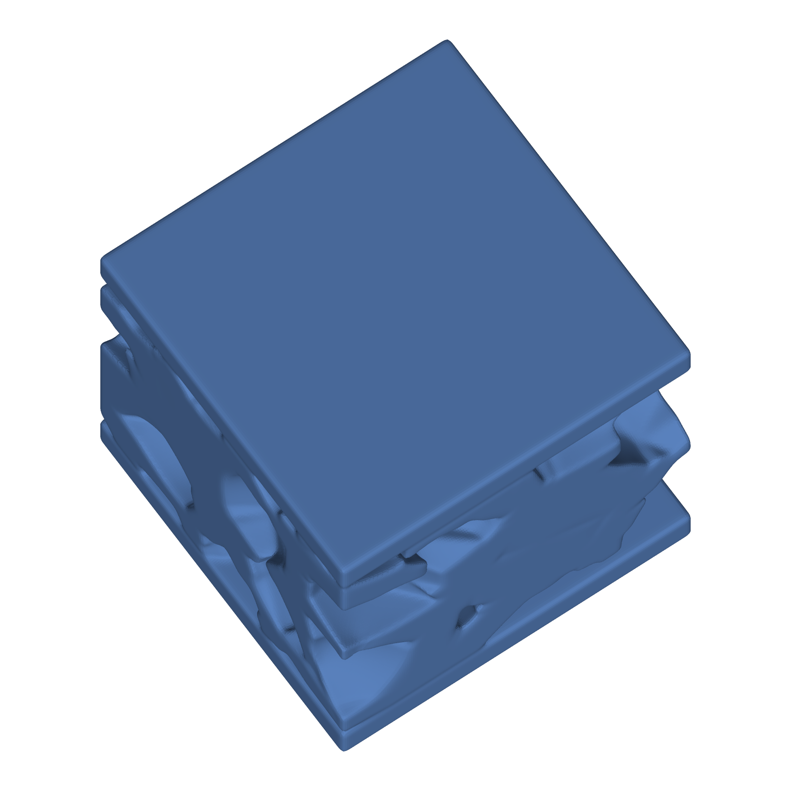
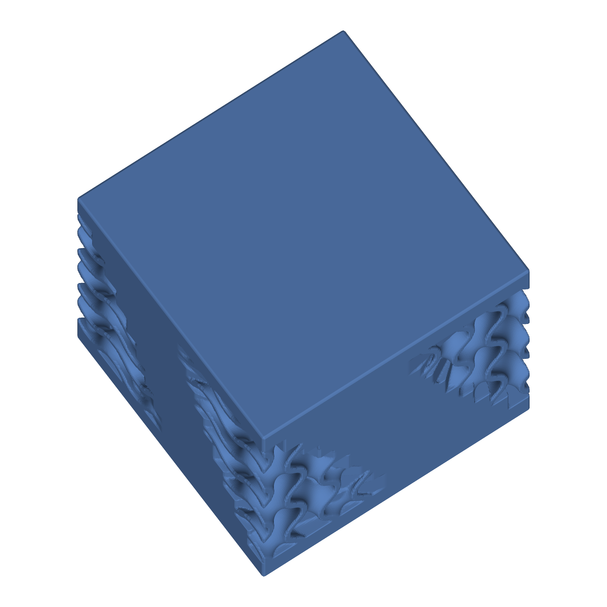
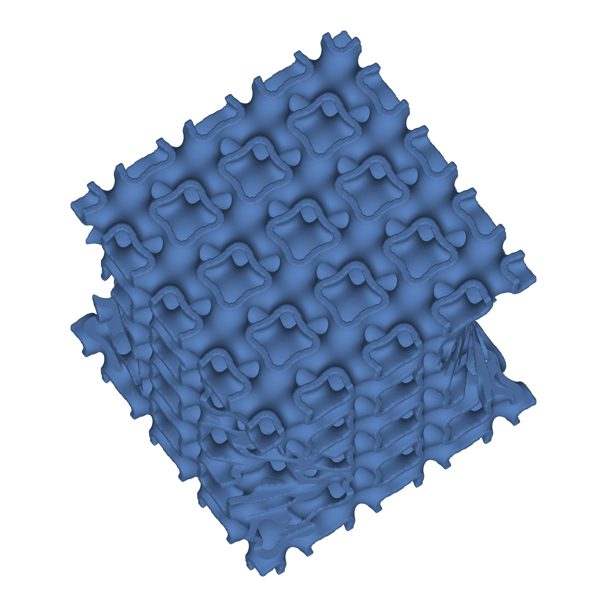
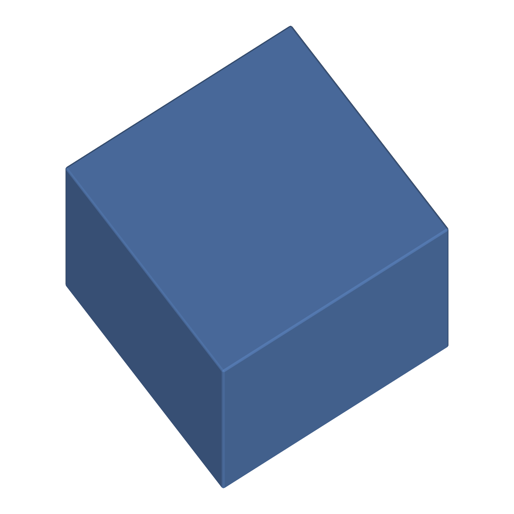

# Structure gallery

**36 of 36 designs pass every check.** Geometry is sampled on a 192-cell grid across the 20 mm box (0.104 mm voxels). Convergence is checked against a 240-cell grid. Each design is a full run through the pipeline (IntentHarness, TopologyHarness, GeometryHarness, ValidationHarness, RepairHarness).

Each folder holds `design.json` (DesignState, metrics, validation, repair_history, coupling metrics), a copy-executable `design.ts` (`node --experimental-strip-types design.ts`), `screenshot.png` (1600 px cut-away view that shows the internal structure) and `screenshot_exterior.png` (1600 px closed exterior). Regenerate: `node --experimental-strip-types --no-warnings scripts/structure_gallery.ts 192`. `gallery.json` holds every check.

## Checks

| Check | Rule |
|---|---|
| harnesses_ok | all five harnesses report ok |
| single_solid | exactly one connected solid (components of at least 27 grid nodes) |
| watertight | the surface mesh has no open edges |
| volume_mc_agreement | mesh volume at 240 cells vs Monte Carlo occupancy of the field (200 000 samples), within 5 % |
| resolution_convergence | mesh volume at 192 vs 240 cells, within 5 % |
| wall_matches_design | lattices and TPMS: median measured wall vs designed strut diameter or sheet thickness, within 25 % |
| periodicity | TPMS: F(p + a) = F(p) on the periodic core (without the skin), 1e-6 |
| fusion identities | shallow fusions only: union, intersection and zoned identities on samples |
| skin_attached | skinned results contain the core and are one solid |
| design_ts_runs | the emitted design.ts runs and exits 0 |

## Deep coupled structures: five rounds, each a different coupling dimension (192 cells)

| Design | Cut-away | Exterior | Volume (mm³) | Components | Handles | Coupling evidence | Checks | Status |
|---|---|---|---|---|---|---|---|---|
| `deep_R1_thickness` R1 thickness: gyroid wall set by a cellular foam field |  |  | 5199.1 | 1 | 324 | t_min_observed_mm=0.5; t_max_observed_mm=1.2; t_mean_near_foam_walls_mm=1.188; t_mean_in_pockets_mm=0.515 | 6/6 | PASS |
| `deep_R2_nested` R2 nested: Kelvin lattice grown inside tubular pores |  |  | 6014.4 | 1 | 4032 | pores=16; pore_infill_solid_fraction=0.4076; lattice_cells=10 | 6/6 | PASS |
| `deep_R3_twist` R3 twist: BCC lattice twisted by a helical angle |  |  | 3223.2 | 1 | 703 | twist_total_deg=90; twist_rate_deg_per_mm=4.5; lattice_cells_xy=13; lattice_cells_z=5 | 6/6 | PASS |
| `deep_R4_blend` R4 blend: Kelvin, gyroid and I-WP joined by smooth minima |  |  | 4844.5 | 1 | 556 | zone_low_solid_fraction=0.3002; zone_mid_solid_fraction=0.5225; zone_high_solid_fraction=0.4749; blend_radius_mm=1.5 | 6/6 | PASS |
| `deep_R5_hierarchy` R5 hierarchy: gyroid infill in every foam pocket |  |  | 7149.6 | 1 | 300 | pocket_fill_fraction=0.3718; solid_fraction=0.824 | 6/6 | PASS |

## Periodic lattices (with 1 mm envelope skin)

| Design | Cut-away | Exterior | Volume (mm³) | Solid fraction | Components | Handles | Wall (mm) | Checks | Status |
|---|---|---|---|---|---|---|---|---|---|
| `lattice_sc` Simple cubic lattice |  |  | 2548.2 | 0.319 | 1 | 176 | 1.000 | 8/8 | PASS |
| `lattice_bcc` BCC lattice |  |  | 3222.6 | 0.403 | 1 | 811 | 0.800 | 8/8 | PASS |
| `lattice_fcc` FCC (octet-truss) lattice |  |  | 3288.6 | 0.411 | 1 | 836 | 0.800 | 8/8 | PASS |
| `lattice_fbcc` FBCC lattice (BCC + FCC + vertical) |  |  | 4285.9 | 0.536 | 1 | 1791 | 0.800 | 8/8 | PASS |
| `lattice_diamond` Diamond lattice |  |  | 3193.3 | 0.399 | 1 | 836 | 0.800 | 8/8 | PASS |
| `lattice_bccz` BCCZ lattice (BCC + vertical edges) |  |  | 3326.0 | 0.416 | 1 | 891 | 0.800 | 8/8 | PASS |
| `lattice_kelvin` Kelvin foam lattice (truncated octahedra) |  |  | 3338.9 | 0.417 | 1 | 1200 | 0.800 | 8/8 | PASS |

## Triply periodic minimal surfaces (with 1 mm envelope skin)

| Design | Cut-away | Exterior | Volume (mm³) | Solid fraction | Components | Handles | Wall (mm) | Checks | Status |
|---|---|---|---|---|---|---|---|---|---|
| `tpms_gyroid` Gyroid |  |  | 3873.4 | 0.484 | 1 | 324 | 0.482 | 9/9 | PASS |
| `tpms_schwarz_p` Schwarz P (primitive) |  |  | 3548.7 | 0.444 | 1 | 109 | 0.496 | 9/9 | PASS |
| `tpms_schwarz_d` Schwarz D (diamond surface) |  |  | 4238.6 | 0.530 | 1 | 666 | 0.475 | 9/9 | PASS |
| `tpms_neovius` Neovius |  |  | 4128.4 | 0.516 | 1 | 577 | 0.519 | 9/9 | PASS |
| `tpms_iwp` I-WP (wrapped package) |  |  | 4082.0 | 0.510 | 1 | 505 | 0.476 | 9/9 | PASS |
| `tpms_lidinoid` Lidinoid |  |  | 5426.9 | 0.678 | 1 | 1530 | 0.469 | 9/9 | PASS |

## Bioinspired base structures (Bioinspired123D families)

| Design | Cut-away | Exterior | Volume (mm³) | Solid fraction | Components | Handles | Wall (mm) | Checks | Status |
|---|---|---|---|---|---|---|---|---|---|
| `bio_helical_generic` Helical plies (Bouligand) |  |  | 7165.9 | 0.896 | 1 | 0 | n/a | 6/6 | PASS |
| `bio_helical_rectfibers` Helical rectangular fibres |  |  | 6581.9 | 0.823 | 1 | 4 | n/a | 6/6 | PASS |
| `bio_helical_cylinfibers` Helical cylindrical fibres |  |  | 5548.4 | 0.694 | 1 | 428 | n/a | 6/6 | PASS |
| `bio_helical_noise` Helical plies with rotation noise |  |  | 7168.4 | 0.896 | 1 | 0 | n/a | 6/6 | PASS |
| `bio_cellular_generic` Cellular foam (Voronoi) |  |  | 5765.4 | 0.721 | 1 | 12 | n/a | 6/6 | PASS |
| `bio_cellular_voronoi` Cellular Voronoi, smoothed |  |  | 5775.1 | 0.722 | 1 | 7 | n/a | 6/6 | PASS |
| `bio_cellular_sandwich` Cellular sandwich |  |  | 6435.5 | 0.804 | 1 | 9 | n/a | 6/6 | PASS |
| `bio_cellular_vorosand` Cellular Voronoi sandwich, smoothed |  |  | 6450.8 | 0.806 | 1 | 5 | n/a | 6/6 | PASS |
| `bio_tubular_generic` Tubular (16 tubules) |  |  | 6994.7 | 0.874 | 1 | 16 | n/a | 6/6 | PASS |
| `bio_tubular_shapesize` Tubular, elliptical section |  |  | 6492.0 | 0.811 | 1 | 16 | n/a | 6/6 | PASS |
| `bio_tubular_layers` Tubular with cortical layers |  |  | 7638.1 | 0.955 | 1 | 16 | n/a | 6/6 | PASS |
| `bio_tubular_noise` Tubular with random scatter |  |  | 6994.7 | 0.874 | 1 | 16 | n/a | 6/6 | PASS |

## Shallow fusions (boolean combination of two complete designs; baseline)

| Design | Cut-away | Exterior | Volume (mm³) | Solid fraction | Components | Handles | Wall (mm) | Checks | Status |
|---|---|---|---|---|---|---|---|---|---|
| `fusion_gyroid_plus_helical` Gyroid union helical plies |  |  | 7407.4 | 0.926 | 1 | 52 | n/a | 7/7 | PASS |
| `fusion_schwarzp_to_gyroid` Schwarz P below, gyroid above (zoned at mid-height) |  |  | 3774.1 | 0.472 | 1 | 270 | n/a | 7/7 | PASS |
| `fusion_kelvin_to_iwp` Kelvin lattice below, I-WP above (zoned), in a 1 mm skin |  |  | 3771.7 | 0.471 | 1 | 924 | n/a | 7/7 | PASS |
| `fusion_bcc_plus_voronoi` BCC lattice union Voronoi foam |  |  | 6921.3 | 0.865 | 1 | 405 | n/a | 7/7 | PASS |
| `fusion_helical_cap_iwp` Helical plies intersected with I-WP |  |  | 2374.8 | 0.297 | 1 | 693 | n/a | 7/7 | PASS |
| `fusion_diamond_plus_lidinoid` Diamond lattice union Lidinoid, 1 mm skin |  |  | 5909.3 | 0.739 | 1 | 1989 | n/a | 7/7 | PASS |

## Findings and limits

- **Resolution.** The earlier gallery used a 96-cell grid (0.21 mm voxels), so 0.4 mm struts were about 4 voxels across and the renders looked faceted. It now uses 192 cells (0.104 mm). Strut and sheet features are about 8 voxels across.
- **Surface-mesh bug fixed.** At 192 cells the sampling border was only 2 cells (0.21 mm). Strut caps that extended past the box were truncated there, which left 8335 open edges in one design and a volume error of about 25 %. The border is now at least 1 mm, and a regression test and a watertight check cover it.
- **Envelope skin.** Every periodic or coupled design has a 1 mm solid skin, which is the same rule as before. Without it the clipped structures are several separate solids: raw Kelvin 16 components and raw Lidinoid 3 components (measured before the skin was added).
- **Coupling is measured.** Each coupled design records a coupling metric from its own field: R1 wall thickness near foam walls vs in pockets, R2 pore infill fraction, R3 twist rate, R4 solid fraction per zone, R5 pocket fill fraction. See `docs/DEEP_FUSION_ROUNDS.md`.
- **Shallow fusions remain as a baseline.** The six `fusion_*` designs are boolean combinations of two complete designs. They are not coupled and are kept only for comparison.
- **Tubular noise** has the same volume as the generic tubule block (samples differ in 4.2 % of points, measured in the earlier probe).
- **Helical plies** (bio_helical_*) appear as stepped plate edges in the 192 renders. Their wall-median column is a ray-chord statistic and is not reported as a wall thickness.
- **Bioinspired123D comparison**: `docs/BIOINSPIRED_COMPARISON.md`. All 12 base codes are implemented. Family routing is 270/270 on the single-family benchmark prompts. Cross-domain prompts (36) still route to one family, and the 14 generic non-bio prompts are flagged as unrecognised.
- **Not done here:** printing or FEA validation, and STEP export for these designs.

